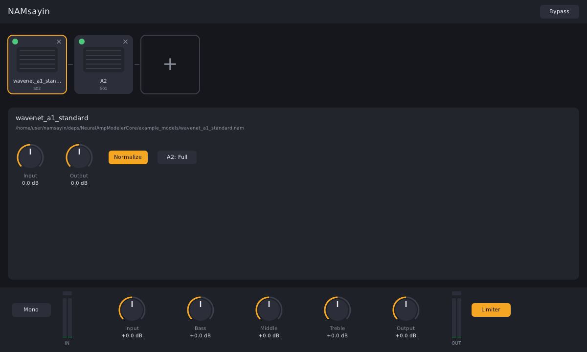

# NAMsayin

A free, open source guitar rig plugin (VST3 and LV2) built on [Neural Amp Modeler](https://github.com/sdatkinson/NeuralAmpModelerCore) and [DPF](https://github.com/DISTRHO/DPF). Runs on Linux and Windows (x86-64 with AVX2).

Status: early prototype — load local NAM models (A1 and A2) and cab IRs (.wav), chain them (with an optional parallel split), and shape the result with the global controls. Built-in tuner and metronome.



 See [docs/Requirements.md](docs/Requirements.md) and [docs/Architecture.md](docs/Architecture.md).

## Building

```sh
git clone --recursive https://github.com/singularity098/namsayin
cd namsayin
cmake -S . -B build -G Ninja -DCMAKE_BUILD_TYPE=Release
cmake --build build
```

Plugins are written to `build/bin/` (`namsayin.lv2`, `namsayin.vst3`).

Linux needs: a C++20 compiler, CMake 3.24+, and the OpenGL/X11 development packages
(`libgl1-mesa-dev libx11-dev libxext-dev libxrandr-dev libxcursor-dev libdbus-1-dev` on Debian/Ubuntu).

Windows: Visual Studio 2022 — `cmake -S . -B build -G "Visual Studio 17 2022" -A x64` then `cmake --build build --config Release`.

## License

MIT — see [LICENSE](LICENSE).
