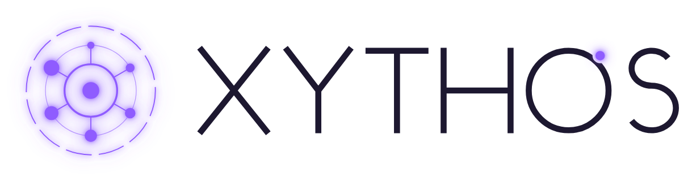
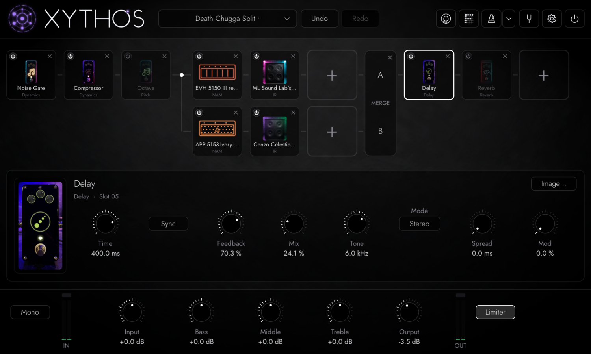

<h1>
  <picture>
    <source media="(prefers-color-scheme: dark)" srcset="resources/logo/xythos.png">
    
  </picture>
</h1>

**A free, open source guitar rig plugin for Linux, Windows and macOS.** Load your [Neural Amp Modeler](https://github.com/sdatkinson/NeuralAmpModelerCore) captures and cab IRs, put them in a chain with over 60 built-in pedals, and play. VST3 and LV2, plus AU on macOS.



> **Status: pre-release.** Everything below works and is tested, but v1.0 isn't out yet: there are no release downloads, so for now you build it yourself (it's easy, see [Building](#building)), or grab the latest build from the [Actions](https://github.com/singularity098/xythos/actions) tab. Bug reports and ideas are welcome in [Issues](https://github.com/singularity098/xythos/issues).

## Features

**Amps and cabs**
- NAM models, both A1 and the newer A2. One A2 file runs in Full or Lite mode (Lite costs less CPU), set globally or per block.
- Cab IRs from `.wav` files, with low and high cut, and zero latency.
- Optional per-block volume normalization from the loudness stored in NAM files, so models come in at a similar level.

**Your library**
- Point it at your NAM and IR folders. It browses them as they're organised, looks inside `.zip` files without unpacking them, and searches everything at once (names, folders, gear metadata).
- Star your favorites. Favorites follow the file's content, so they survive renaming and moving.
- Put an image next to a model (`My Amp.nam` + `My Amp.png`) and it shows on the block.

**The chain**
- Up to 32 blocks, left to right. Drag to reorder, middle-click to remove, double-click to replace.
- Split the chain into two parallel paths and merge them back, with balance, level, pan and phase invert per path. Run two amps at once, or a wet/dry rig. The second path can run on a second CPU core.
- Zero latency: nothing in the chain adds latency, and the plugin reports zero to your DAW.
- Mono or stereo processing, with a global input level, bass/middle/treble, output level, meters and an output limiter.

**Built-in pedals**, written from scratch, most with several types:

| Category | Pedals |
| --- | --- |
| Distortion | Boost, Overdrive, Distortion, Fuzz, Gated Fuzz, Envelope Drive, Bitcrusher |
| Dynamics | Compressor, Noise Gate, Volume, Auto Swell, Kill Switch |
| EQ | Graphic EQ, Parametric EQ |
| Modulation | Chorus (and vibrato), Flanger, Phaser, Barber Pole, Modulation Sweeper, Tremolo, Rotary, Doubler, Ring Mod, Warble, Slicer |
| Reverb | Reverb (room, hall, plate), Spring Reverb, Shimmer, Freeze, Bloom Reverb, Gated Reverb |
| Delay | Delay, Doppelganger Delay, Tape Echo, Ducking Delay, Reverse Delay, Pitch Delay, Beat Repeat, Looper |
| Pitch | Octave, Poly Octave, Pitch Shifter, Whammy, Harmonizer, Detune, Capo, Sustainer |
| Synth | Synth, Super Saw, FM Synth, Fold Synth, Acid Synth, String Machine, Chip Synth, Poly Chip (polyphonic), Arpeggiator, Organ |
| Filter | Filter, Robot Filter |
| Wah | Wah, Auto Wah, Talk Box |

A few that you won't find everywhere: the **Doppelganger Delay**, whose echoes alternate between a flanger and a chorus; the **Modulation Sweeper**, which morphs back and forth between two or three of chorus, flanger, phaser and vibrato; and the **Poly Chip**, an 8-bit synth that follows chords.

Delay times and modulation rates can sync to your DAW's tempo, and synced LFOs lock to the beat.

**Built-in tools**
- **Tuner**: accurate to ±0.1 cent from a 5-string bass's low B to the 24th fret of the high E. Needle or strobe view, adjustable reference pitch (A4 = 415–466 Hz), mutes your guitar while you tune.
- **Metronome**: 20–300 BPM, tap tempo, odd meters with beat grouping (7/8 as 2+2+3), per-beat accents, subdivisions including swing, tempo and gap trainers, and DAW sync. Sample-accurate.

**Everything else**
- Presets: save them into your own folders, set a default for new instances, and export a preset with its NAM files, IRs and images embedded to share it. If a file is missing when a preset loads, Xythos finds it in your library by its content.
- Undo and redo (200 steps) for every chain edit and block setting.
- Every block control can be automated in your DAW and mapped to MIDI (right-click → MIDI Learn). Automation and MIDI follow the block when you move it.
- Hover over any knob, button or pedal for a plain-English explanation of what it does.
- A resizable, HiDPI-aware, very dark interface, with a highlight colour of your choice.

## Requirements

- **Linux or Windows**, 64-bit x86, or **macOS 11** (Big Sur) or later, on Apple Silicon or Intel.
- **On x86 (including Intel Macs), a CPU with AVX2 and FMA**: Intel Haswell (2013) or newer, AMD Excavator or Zen or newer.
- **A DAW that hosts VST3, LV2 or (on macOS) AU plugins.** Xythos is mainly tested in [Reaper](https://www.reaper.fm/). In Reaper on Linux, the VST3 version redraws more smoothly than the LV2 one.

## Installing

Copy the plugin bundles (built below, in `build/bin/`) to your plugin folders:

| | VST3 | LV2 | AU |
| --- | --- | --- | --- |
| Linux | `~/.vst3/xythos.vst3` | `~/.lv2/xythos.lv2` | |
| Windows | `C:\Program Files\Common Files\VST3\xythos.vst3` | `%APPDATA%\LV2\xythos.lv2` | |
| macOS | `~/Library/Audio/Plug-Ins/VST3/xythos.vst3` | `~/Library/Audio/Plug-Ins/LV2/xythos.lv2` | `~/Library/Audio/Plug-Ins/Components/xythos.component` |

Then rescan plugins in your DAW and add **Xythos** to a track.

On macOS the plugins aren't signed with an Apple Developer ID yet, so after downloading them, clear the quarantine
flag or macOS will refuse to load them:

```sh
xattr -dr com.apple.quarantine ~/Library/Audio/Plug-Ins/*/xythos.*
```

## Getting started

1. Open **Settings** (the gear at the top right) and choose your NAM folder and IR folder.
2. Click **+** in the chain to add a block: pick **NAM** for an amp, **IR** for a cab, or any pedal category. The search box at the top searches all of them.
3. Click a block to see its controls below the chain. Drag blocks to reorder them; right-click one for bypass, replace, remove and MIDI learn.
4. Hover the gap between two blocks for buttons to insert a block there or split the chain.
5. Save the rig from the preset menu at the top left.

Handy shortcuts: double-click a knob to reset it, Shift-drag (or Shift + mouse wheel) for fine control, Ctrl+Z / Ctrl+Shift+Z to undo and redo.

## Building

You need a C++20 compiler and CMake 3.24 or newer.

**Linux** (Debian/Ubuntu package names):

```sh
sudo apt install build-essential cmake ninja-build git \
    libgl1-mesa-dev libx11-dev libxext-dev libxrandr-dev libxcursor-dev libdbus-1-dev
git clone --recursive https://github.com/singularity098/xythos
cd xythos
cmake -S . -B build -G Ninja -DCMAKE_BUILD_TYPE=Release
cmake --build build
```

**macOS** (Xcode or its Command Line Tools, and [Homebrew](https://brew.sh) for CMake and Ninja); builds a
universal binary:

```sh
brew install cmake ninja
git clone --recursive https://github.com/singularity098/xythos
cd xythos
cmake -S . -B build -G Ninja -DCMAKE_BUILD_TYPE=Release
cmake --build build
```

**Windows** (Visual Studio 2022):

```sh
git clone --recursive https://github.com/singularity098/xythos
cd xythos
cmake -S . -B build -G "Visual Studio 17 2022" -A x64
cmake --build build --config Release
```

The plugins are written to `build/bin/` (`xythos.vst3` and `xythos.lv2`, and `xythos.component` on macOS). If you cloned without `--recursive`, run `git submodule update --init --recursive` first.

To run the tests: `ctest --test-dir build --output-on-failure`.

## Contributing

Bug reports, ideas and pull requests are welcome. For a larger change, open an issue first so we can talk it through. The design is described in [docs/Architecture.md](docs/Architecture.md) and the agreed feature list is in [docs/Requirements.md](docs/Requirements.md). New effects are one class and one line in the block registry; see `src/engine/BlockRegistry.cpp`.

## Credits

Xythos is built on:

- [NeuralAmpModelerCore](https://github.com/sdatkinson/NeuralAmpModelerCore) by Steven Atkinson (MIT), with [Eigen](https://eigen.tuxfamily.org/) and [nlohmann/json](https://github.com/nlohmann/json)
- [DPF](https://github.com/DISTRHO/DPF), the DISTRHO Plugin Framework (ISC), with NanoVG
- [FFTConvolver](https://github.com/HiFi-LoFi/FFTConvolver) (MIT), [miniz](https://github.com/richgel999/miniz) (MIT), [xxHash](https://github.com/Cyan4973/xxHash) (BSD-2), [libwebp](https://github.com/webmproject/libwebp) (BSD-3, decoding the built-in images) and [doctest](https://github.com/doctest/doctest) (MIT)
- The [Jost](https://github.com/indestructible-type/Jost) font (SIL Open Font License)

Also from the same author: [Fretbored](https://singularity098.github.io/fretbored/), a free web app for learning the guitar neck.

## License

MIT. See [LICENSE](LICENSE).
